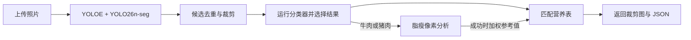

# 食材图像识别与营养分析

上传一张照片，系统会裁剪候选食材、逐个识别，再返回裁剪图、分类结果和每 100 g 的参考营养值。

## 实际输出

同一张混合食材照片产生了 23 个候选，首轮去重后剩下 17 个，合并和清理后输出 13 张裁剪图。其中一张裁剪图在分割阶段被标为 `apple`，分类器随后将它识别为小番茄，营养表返回以下结果。

```json
{
  "food_name": "ミニトマト",
  "confidence": 0.9994,
  "unit": "每100g",
  "match_name": "cherry_tomato",
  "match_method": "exact",
  "source_name": "UK CoFID",
  "energy_kcal": 22.0,
  "protein_g": 1.1,
  "fat_g": 0.5,
  "carbohydrate_g": 3.6
}
```

以上字段摘自一次本地运行的 `nutrition_results`。0.9994 是该裁剪图的分类分数。

## 我的贡献

| 工作 | 实现 |
| --- | --- |
| 多食材裁剪 | 用两组 YOLOE 提示词和 YOLO26n-seg 生成候选，再按掩膜 IoU、包含率及模型分工去重。保留和移除的候选分别记录到 CSV。 |
| 肉类模型训练 | 基于预训练 ResNet-50 加入 Gabor 纹理分支，训练鸡肉、猪肉、牛肉和 Other 四分类模型。另用 DeepLabV3+ 与 ResNet-101 训练肉区精分割。 |
| 脂瘦分析与营养数据 | 用 OpenCV 颜色特征与 K-means 区分脂肪、瘦肉和不确定像素，匹配营养参考值并保留数据来源。 |
| 客户端与接口 | 制作 Flutter 手机端并与 FastAPI 联调，支持图片上传、任务轮询和结果显示。本仓库收录后端。 |

## 训练与验证

| 模型 | 已核对的结果 | 在当前后端中的位置 |
| --- | --- | --- |
| ResNet-50 + Gabor 肉类四分类 | 第 36 轮保存的权重记录了 **97.62% 验证准确率** | `meat.pth` 供肉类分类器加载 |
| DeepLabV3+ + ResNet-101 肉区分割 | 验证集选阈值为 **0.80**。Dice **0.978**、IoU **0.958** | 独立训练实验。当前后端将通用裁剪直接传给脂瘦模块 |

训练脚本和训练数据保存在原课程项目中。上表是两项任务各自的验证结果。整套系统的表现还需要用手机实拍单独评估。

## 后端流程



每张裁剪图会尝试运行已配置的分类器。后端优先采用达到阈值的水果或蔬菜结果，再比较专门模型的候选。

| 源码 | 职责 |
| --- | --- |
| [main.py](food_server/main.py) | 上传接口、任务状态和分析流程 |
| [image_cutter.py](food_server/modules/image_cutter.py) | 分割、去重、裁剪及 CSV 日志 |
| [food_classifier.py](food_server/modules/food_classifier.py) | 模型加载、推理和结果选择 |
| [fat_lean_ratio.py](food_server/modules/fat_lean_ratio.py) | 像素聚类及脂瘦面积比例 |
| [nutrition_analyzer.py](food_server/modules/nutrition_analyzer.py) | 名称匹配和参考营养值计算 |

## 本地启动

原课程环境使用 Python 3.10。在仓库根目录使用 PowerShell 执行以下命令。

```powershell
python -m venv .venv
.\.venv\Scripts\python.exe -m pip install -r requirements.txt
.\.venv\Scripts\python.exe -m uvicorn main:app --app-dir food_server --host 127.0.0.1 --port 8000
```

启动后打开 [Swagger UI](http://127.0.0.1:8000/docs)，或访问 [健康检查](http://127.0.0.1:8000/health)。查看接口文档和健康检查无需模型权重。

### 准备图像分析资源

完整推理需要自行准备有权使用且与当前加载代码兼容的权重和营养表。以下文件均由 Git 忽略。

| 放置位置 | 文件 |
| --- | --- |
| `food_server/models/` | `yoloe-26s-seg.pt`、`yolo26n-seg.pt` |
| `food_server/modules/` | `fruit.pth`、`vegetable.pth`、`mushroom.pth`、`meat.pth` |
| `food_server/modules/` | 海鲜分类使用兼容的 `seafood_resnet50_best.pth`。此权重缺失时，该分类器返回单项错误，其他分类器仍可运行。 |
| `food_server/modules/` | 水果和菌菇权重未内嵌类别名时，放入 `class_names_fruit.json` 和 `class_names_mushrooms.json` |
| `food_server/modules/` | `NutritionFacts.xlsx`，首行至少包含 `EnglishName`、`エネルギー`、`たんぱく質`、`脂質`、`炭水化物` |

### 调用 API

```powershell
curl.exe -F "file=@path/to/food.jpg" http://127.0.0.1:8000/analyze
```

| 接口 | 用途 |
| --- | --- |
| `GET /health` | 检查服务是否启动 |
| `POST /analyze` | 上传图片并等待结果 |
| `POST /analyze/start` | 启动后台分析，返回 `task_id` |
| `GET /analyze/status/{task_id}` | 查询处理阶段和结果 |

照片流程未测量食材重量，营养结果使用每 100 g 的参考值。脂瘦计算估算的是切面面积，受光照、角度和背景影响。任务状态保存在进程内存中，新分析会清理旧裁剪图，适合逐次本地演示。
